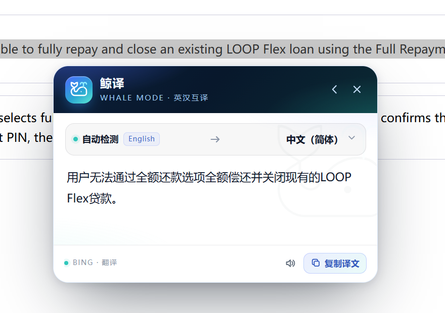

# 鲸译 · Whale Translator

**English** | [中文](README.zh.md)

A selection translator for **DeepSeek Harness**, plus a companion browser extension for any web page. Select text, click **Translate**, and read only the translation. Nothing is sent until you click.



## Product map

| Surface | Status | Where it works | How to install |
|---|---|---|---|
| **DSH plugin** | Available, `1.0.0` | DeepSeek Harness Web UI | Plugin Manager / profile bundle |
| **Browser extension** | Available, unpacked | Edge / Chrome, any `http(s)` page | Load unpacked (Developer mode) |
| **Desktop all-app** | Planned | Word, WeChat, any Windows app | Separate desktop program, not in this package |
| **Store / CRX install** | Store kit ready; not yet submitted | A Developer-mode-free install | Edge Add-ons listing or enterprise policy |
| **DSH route auth** | Available (per-process page token) | DSH backend hardening | `ctx.translator` still planned |

The two available surfaces are independent: the DSH plugin runs inside Harness, the browser extension runs in Edge/Chrome, and either can be used without the other.

## Features

- **Selection first, translation second.** A whale toolbar appears above the selection. Translation starts only after **Translate** is clicked.
- **Chinese ↔ English.** The source language is detected locally; the target can be switched in the card.
- **Line breaks are preserved.** The newline skeleton is verified after the provider responds; if it changes, the text is retranslated line by line and the original leading/trailing whitespace is restored.
- **Only the translation.** The result card does not repeat the source text or add a “Translation:” prefix.
- **Toolbar actions.** Copy, read aloud with the browser speech engine, local extractive summary, search in a Bing tab, and a small more menu.
- **Fast failure, not a slow fallback.** Bing is the only upstream. On a timeout or network error the card fails quickly and offers **Retry**; the old slow MyMemory fallback has been removed.
- **Bounded work.** Selections are capped at 12,000 characters. Long text is split into chunks and translated with limited concurrency. The DSH route has a 12-second total budget; the client waits 15 seconds.
- **Whale theme.** A custom line-art whale, deep-ocean navy, bioluminescent cyan, and a wave-glass card. The toolbar stays dark in both themes; the card follows the host theme.

## Install

### A. DSH plugin (recommended inside Harness)

The package is a standard Harness bundle with `dsh.bundle.patch` and a `dsh.client` half.

1. Open the DSH Plugin Manager.
2. Install the directory `plugins/whale-translator` (or add it as a profile bundle).
3. Let the client module reload, or restart DSH.

No npm dependencies are added. The package name is `@local/whale-translator`.

> After changing `client.js` or `index.js` by hand, restart DSH. The client bundle is served immutably, and a page refresh alone keeps the old revision.

### B. Browser extension (Edge / Chrome)

1. Open `edge://extensions` (Chrome: `chrome://extensions`).
2. Enable **Developer mode**.
3. Click **Load unpacked** and select `plugins/whale-translator/extension`.
4. Open any `http://` or `https://` page and select text.

> **Developer mode is required for the unpacked extension.** Edge/Chrome only load unpacked extensions when Developer mode is on. Loading a `.crx` does **not** by itself remove this requirement: a Developer-mode-free install needs a store listing, or an enterprise policy that force-installs a signed CRX from an update URL.

**Without Developer mode, your options are:**

| Option | What it needs | Notes |
|---|---|---|
| Edge Add-ons | Individual or company account, no Edge registration fee, review | Store kit is prepared; not submitted yet. The clean Developer-mode-free path for other people. |
| Enterprise policy | Admin rights, hosted signed CRX + update XML | Technical on a personal PC, but intended for managed fleets; not worth it for one person. |
| DSH plugin only | DSH running | Covers Harness pages only, no Developer mode |
| Portable launch with `--load-extension` | A shortcut that starts the browser with the flag | Advanced/testing only; not a normal install, and ignored if the browser is already running |

Browser-internal pages (`edge://`, `chrome://`, the extension store) cannot be injected. This is a browser restriction, not a setting.

### C. Update / uninstall

- **DSH plugin:** reinstall the directory or update the linked package, then restart DSH.
- **Extension:** `edge://extensions` → **Reload** after changing extension files; **Remove** to uninstall.
- The unpacked extension points at the folder on disk. Keep `plugins/whale-translator/extension` in place; if you move it, reload the extension from the new path.

## Use

### In DSH

Select text in a conversation. The toolbar appears above the selection. Click **Translate**. The result card opens below the selection and keeps the original line breaks.

- Selections in `input`, `textarea`, `select`, `contenteditable`, `pre`, and `code` are intentionally ignored so the toolbar never interrupts editing or code copying.
- Cross-origin iframe selections are outside the DSH document and are not seen.
- Closing the toolbar (X, Escape, **Close toolbar**, scroll, or a click elsewhere) suppresses the same selection until the next interaction.

### In the browser

Select text on a normal web page, including a `contenteditable` editor (Jira, Confluence, Notion, and similar). Click **Translate**. The result card appears near the selection.

- `input` and `textarea` selections are skipped. `contenteditable` is supported.
- `http(s)` pages and frames are supported. Browser-internal pages are not.
- The card supports retry, copy, read aloud, and local summary. The **More** menu also offers copy original, copy translation, and close.

## Permissions and privacy

### DSH plugin

| Item | Detail |
|---|---|
| Route | `POST /api/dsh/whale-translator/translate` |
| Outbound data | The selected text, only when **Translate** is clicked |
| Upstream | `edge.microsoft.com` (Microsoft Translator / Bing) |
| Local data | Source text, translation, and summary stay in the page |
| Disk | The plugin writes no translation history to disk |
| Limits | 12,000 selected characters; 96 KiB request body; 12-second host budget |

### Browser extension

| Permission | Why it is needed |
|---|---|
| `host_permissions: https://edge.microsoft.com/*` | Send the translation request from the MV3 service worker |
| `clipboardWrite` | Copy original / translation |
| `content_scripts: <all_urls>` | Show the toolbar on web pages |
| No `tabs`, `storage`, or `webRequest` | Not requested |

The extension sends text only after **Translate** is clicked. It keeps no history and writes nothing to disk; the cache lives in the service worker’s memory.

## How it works

### DSH plugin

- `client.js` registers a frame-wide overlay in the `shell.overlay` slot. It listens for `mouseup`, `touchend`, `selectionchange` (debounced), and Shift+keyup; excludes editable/code regions; and anchors the toolbar to the selection’s viewport rect.
- `index.js` registers one same-origin route. It validates `application/json`, caps the body at 96 KiB, retries HTTP 429/5xx once, translates chunks with limited concurrency, and caches successful results in memory.
- The route uses the unofficial Edge translator endpoint. It returns a fast error and a retry button if the endpoint is unavailable.

### Browser extension

- A Manifest V3 service worker performs translation; a content script renders the toolbar and card.
- The content script uses a fixed, page-level overlay with scoped `wt-` CSS. Only the toolbar/card area takes pointer events; the rest of the page stays interactive.
- The extension warms the service worker/TLS when a page loads and when a selection opens the toolbar, reducing cold-start latency.
- No DSH process is involved; the extension works while DSH is closed.

## Security status

The DSH route requires a **per-process page token** in addition to the same-origin, `application/json`, and body-size checks. The token is generated when the host plugin loads, injected into the DSH page head as a meta tag, and sent by the client as `x-whale-translator-token`. If the meta tag is missing, the client fetches the token from a same-origin `GET` on the same route. Requests without the token receive `403` and do not reach Bing. The token rotates when the host restarts; refresh the DSH page, and fully restart DSH if the running client predates the host change.

The route does not store or log selected text. It is still not a replacement for DSH’s own authentication if the Web server is exposed beyond localhost; keep the server on localhost or behind your normal access controls.

Planned:

- Integrate DSH’s `ctx.translator` service so the plugin follows the app’s translation provider and credential settings.
- Keep the current fast Bing path as a fallback while the integration is validated.

These are the remaining medium-risk items from the code review.

## Troubleshooting

| Symptom | Check |
|---|---|
| Toolbar never appears in DSH | Is the plugin enabled? Does the selection start outside `input`/`textarea`/`contenteditable`/`pre`/`code`? Is the plugin client bundle the current revision? Restart DSH after edits. |
| Toolbar never appears in the browser | Is the extension enabled? Is **Site access** set to **On all sites**? Is the page an `edge://`/`chrome://` page or the extension store? Reload the page after installing/reloading the extension. |
| Toolbar appears but Translate does nothing | Check the extension’s **Errors** button on `edge://extensions`; reload the extension; try a normal `http(s)` page. |
| “扩展已更新或后台未启动，请刷新页面后重试” | Reloading an unpacked extension invalidates pages that were already open. Refresh the page, or use the card’s **刷新页面** button; if it persists, reload the extension and refresh again. |
| Translation fails with HTTP 429/timeout | The public endpoint is throttled or unreachable. Wait a moment and press **Retry**; there is no automatic slow fallback. |
| “翻译鉴权失败，请刷新页面或重启 DSH” | The host plugin regenerated its page token. Refresh the DSH page; if it persists, fully restart DSH. |
| First translation is slow | The service worker or TLS connection is cold. The extension warms it on page load; a retry is usually faster. |
| Extension disappears after restarting Edge | The unpacked extension depends on its folder path. Keep the folder in place; reload it from `edge://extensions`. |
| `.crx` install is blocked | A CRX still needs Developer mode or an enterprise policy. Use the store or policy path for a Developer-mode-free install. |

## Limitations

- **Browser extension:** browser pages only; not Word, WeChat, or other desktop apps.
- **Developer mode:** required for the current unpacked install. A store listing or enterprise policy is required to remove that requirement.
- **Unofficial upstream:** the Edge translator endpoint is not a contracted API; availability and rate limits are not guaranteed.
- **Text limit:** 12,000 characters per translation; no streaming output.
- **UI language:** the in-product copy is Chinese; this manual is bilingual.
- **DSH scope:** the plugin sees only the DSH page; it cannot inject other tabs or origins.

## Roadmap

### 1. Desktop all-app version

A separate desktop program, not part of this package. Target behavior, similar to Doubao’s desktop selection tool:

- Windows global mouse hook (and macOS event tap on macOS).
- Read the selection with UI Automation or accessibility APIs; fall back to clipboard copy/restore.
- Show a topmost, click-through-where-needed overlay near the cursor.
- Call the same translation service; keep the “only on click” privacy rule.

This requires a native/desktop host, code signing, and installer work. The current browser extension cannot provide it.

### 2. Store / CRX packaging

- Publish to Edge Add-ons and/or Chrome Web Store for a normal, Developer-mode-free install.
- For managed machines, host a signed CRX + update manifest and use `ExtensionSettings` / `ExtensionInstallForcelist`.
- A `.crx` alone is not a bypass for Developer mode. Packaging also requires protecting the signing key; it must never be committed to the repository.

### 3. DSH `ctx.translator`

The per-process route token is implemented. The remaining step is to prefer DSH’s `translator` service for provider/credential consistency, while keeping the same-origin/body/content-type/token checks as defense in depth.

## Development

| Path | Purpose |
|---|---|
| `client.js` | DSH client overlay and toolbar/card UI |
| `index.js` | DSH host route, Bing request, chunking, cache |
| `extension/` | Standalone MV3 extension (service worker, content script, CSS, icons) |
| `test/` | Node tests for the host, route, client contract, and extension core |
| `store/` | Edge Add-ons submission kit: listing copy, privacy policy, icons, screenshots, package |
| `locale/` | DSH plugin metadata |
| `THIRD_PARTY_NOTICES.md` | Lucide whale attribution |

Run the tests:

```sh
npm test
```

The tests mock `fetch`; they do not call the network. There are no npm runtime dependencies.

## Version

`1.0.0` — DSH plugin and unpacked browser extension.

The whale glyph is an original composition built on the Lucide `whale` outline (ISC). See [THIRD_PARTY_NOTICES.md](THIRD_PARTY_NOTICES.md).

This project is released under the MIT License. See [LICENSE](LICENSE).
